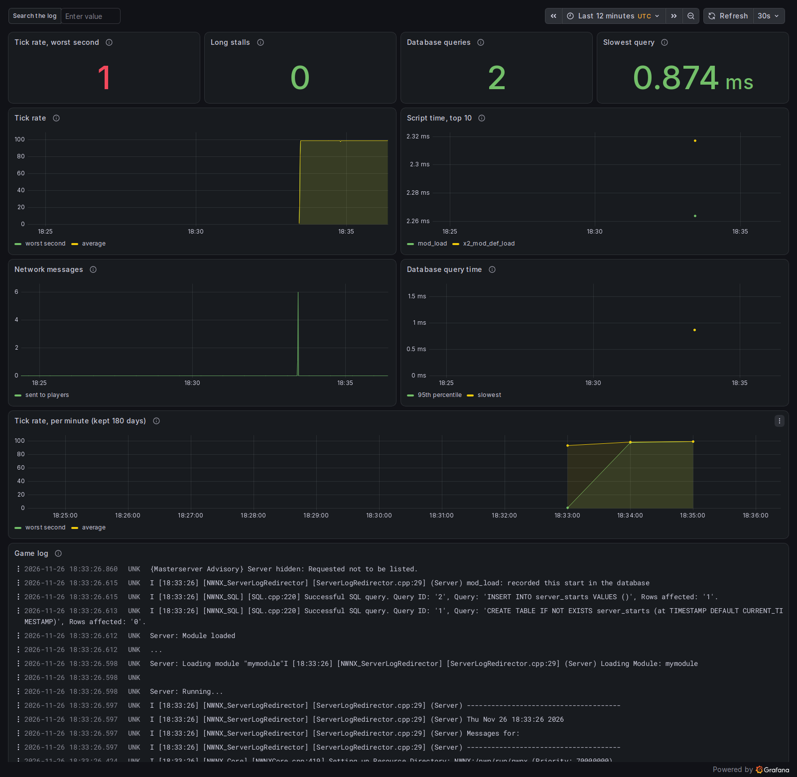
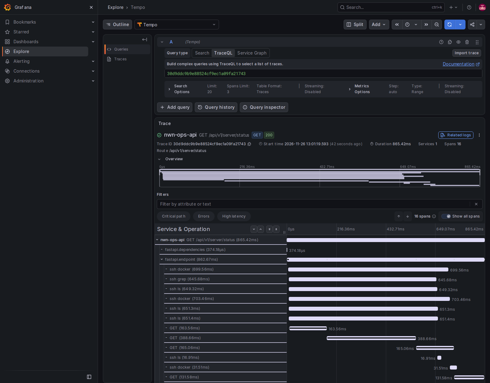

# Chapter 13. Monitoring and alerting

**Status:** tiers 2 and 3 are written and tested. Tier 1 is covered by chapter 4: the game's container checks itself
every 30 seconds, and `docker compose ps` shows you the answer. Tier 2 is an outside watchdog and one alert channel;
tier 3, further down, adds the game's own numbers in dashboards, its logs searchable in one place, and request
traces, all on the control host and on the private network only.

**Tier 1, in one paragraph.** With one machine and one person, [chapter 4's health check](04-game-server.md#4-generic-start-it)
is enough: the container asks its own server the question a player's game asks, and shows `(healthy)` when the
answer comes back. It tells you the state when you look. It doesn't tell you when you're not looking, and it can't
see anything from outside the machine. That's what tier 2 adds.

---

## Tier 2. An outside watchdog and one alert channel

### What you learn

How to be told, on your phone, when your game stops answering, before a player has to tell you. And just as
important: how to be told once, not every two minutes, and to hear when it's fine again.

When you're done, you'll have:

- a small **watchdog** on the control host, a script and a timer, that every two minutes asks the game the
  question a player's game asks, fetches your website, and looks at its certificate;
- the game host's **disk space and last night's backup** reported to it over the private network, by a script
  that can do nothing else;
- **one alert channel**, a Discord webhook, where every alert arrives: one message when something breaks, one when
  it's fixed, and a weekly "still watching" so silence means something;
- a **pause** for planned work, so a restart you meant doesn't wake anyone.

**Time:** about twenty minutes. The watchdog is one Python file with nothing to install; Ubuntu already has Python.

### What Layonara does

- **The watchdog lives outside all our machines,** as a small Cloudflare Worker on the free plan. Every five minutes
  it makes eight checks in parallel: the game (through Beamdog's public server list), the website, a page that
  needs the website's database, the forum, the wiki, the sign-in service, the NWSync server and Coolify.
- **An alert goes out after two failures in a row**, so about ten minutes, once per outage. One "back up" message
  follows, with how long it was down. Everything that changed in one run goes into one message.
- **Red alerts mention our admins; recoveries mention nobody.**
- **A pause key** with an expiry time keeps it quiet during planned work, and lifts itself.
- **A weekly message on Mondays** lists the checks, anything down, and the game's player count.
- **One Discord webhook for every alert** we have: the watchdog, the backups' own failure messages, a watcher
  that complains when a backup is more than 36 hours old, and the alert rule in our dashboards.

Our Worker reads the game's state from Beamdog's server list, because that's what a Worker can reach: Workers
can't send the UDP question a game server answers. This chapter's watchdog asks the game itself, which works
whether or not you're in the public list, and runs on a machine you already have.

### The human playbook

You need chapter 1's tier 2 (a control host, and the private network between it and the game host), and chapter
12's nightly backup on the game host. The examples use `CONTROL` and `GAME` for the two machines' public addresses,
`10.77.0.1` and `10.77.0.2` for their private ones, and `www.example.org` for your website.

The files are in [`templates/watchdog`](../templates/watchdog): the watchdog itself, its settings, a timer, and the
small report script for the game host. They're short, and the watchdog's first lines explain how it behaves.

#### 1. GENERIC. Know what it watches, and from where

| Check | How | Fails when |
|---|---|---|
| `game` | the game's own UDP question, to its public address, up to three tries | no answer in about 9 seconds |
| `website` | an HTTPS request for your page | anything but 200, or the page lacks words you name |
| `website certificate` | the certificate the page is served with | fewer than 14 days left, or not valid |
| `game host` | an SSH call over the private network | the game host doesn't answer it |
| `game host disk /` | the report from the game host | 90% full or more |
| `game host backup` | the report from the game host | the newest backup is more than 26 hours old |

The watchdog runs on the control host, so it sees the game from outside, across the internet, the way your players
do. If the whole game host stops, you hear about it twice in one message: the game and the report.

It is deliberately not a Coolify service. It's a plain timer on the control host, so a problem with Coolify, or
with Docker, can't silence it.

What it can't do is watch the machine it runs on. If the control host goes away, the watchdog goes with it, and
says nothing. The weekly message is there for that: if Monday comes and nothing arrives, look. Step 9 shows a
second, small copy on the game host that watches the control host back, if you'd like to close that gap properly.

#### 2. ADAPT. Make the alert channel

Change: the channel, if you'd rather not use Discord (step 8).

In Discord: your server's settings, **Integrations**, **Webhooks**, **New Webhook**. Give it a name such as
`Alerts`, choose a channel only your staff can see, and **Copy Webhook URL**.

That address is a password of sorts: anyone who has it can post in that channel. Keep it out of git and out of
chat. If it ever leaks, **Delete Webhook** on the same page and make a new one.

#### 3. GENERIC. Install it on the control host

From this repository, on your own computer:

```sh
scp -r templates/watchdog nwn@CONTROL:watchdog
ssh nwn@CONTROL 'sudo install -m 755 watchdog/nwn-watchdog.py /usr/local/bin/nwn-watchdog && sudo useradd --system --create-home --home-dir /var/lib/nwn-watchdog --shell /usr/sbin/nologin nwn-watchdog && sudo install -d -m 750 -g nwn-watchdog /etc/nwn-watchdog && sudo install -m 640 -g nwn-watchdog watchdog/watchdog.conf.example /etc/nwn-watchdog/watchdog.conf && sudo install -m 644 watchdog/nwn-watchdog.service watchdog/nwn-watchdog.timer /etc/systemd/system/ && sudo systemctl daemon-reload && echo installed'
```

It runs as a user of its own, `nwn-watchdog`, which can read its settings and write its memory in
`/var/lib/nwn-watchdog`, and nothing else.

Then the webhook address. This reads it from your keyboard, so it never lands in your shell's history:

```sh
ssh nwn@CONTROL 'read -rs -p "Webhook address: " u; echo; printf "%s\n" "$u" | sudo install -m 640 -g nwn-watchdog /dev/stdin /etc/nwn-watchdog/webhook && echo saved'
```

And the first message, to see the road works:

```sh
ssh nwn@CONTROL 'sudo -u nwn-watchdog nwn-watchdog test'
```

It prints `sent`, and the channel shows "test message from ...: alerts arrive here".

#### 4. ADAPT. Tell it what to watch

Change: the name, the game's address, the website's address, and a few words from your page.

```sh
ssh -t nwn@CONTROL 'sudo nano /etc/nwn-watchdog/watchdog.conf'
```

The file explains each line. Use the game's **public** name or address, the one players type, so the check takes
their road. The `expect` line is worth filling in: a few words from your page, so an error page that answers
politely with 200 still counts as down.

#### 5. GENERIC. Let the game host report its disk and backup

The watchdog needs two facts that only the game host knows. It gets them with an SSH key that can run one small
script, [`watchdog-report.sh`](../templates/watchdog/watchdog-report.sh), and nothing else: no shell, no files, no
tunnels, and only from the control host's private address.

The script goes beside the backup script on the game host:

```sh
scp templates/watchdog/watchdog-report.sh nwn@GAME:game/
ssh nwn@GAME 'chmod 755 game/watchdog-report.sh && game/watchdog-report.sh'
```

It prints something like `disk 17 /` and `backup 20261126-141703`.

Then the key. The first command makes it on the control host; the second puts it on the game host with its locks:
`restrict` (no shell, no forwarding), `from=` (only from the private address) and `command=` (only the report).
The third tells the watchdog the game host's own key, fetched from the game host itself, so it never has to trust
a first answer blindly.

```sh
ssh nwn@CONTROL 'sudo -u nwn-watchdog sh -c "mkdir -p -m 700 ~/.ssh && ssh-keygen -q -t ed25519 -N \"\" -C nwn-watchdog -f ~/.ssh/id_ed25519" && sudo cat /var/lib/nwn-watchdog/.ssh/id_ed25519.pub' > watchdog.pub
{ printf 'restrict,from="10.77.0.1",command="/home/nwn/game/watchdog-report.sh" '; cat watchdog.pub; } | ssh nwn@GAME 'cat >> ~/.ssh/authorized_keys' && rm watchdog.pub
ssh nwn@GAME 'cat /etc/ssh/ssh_host_ed25519_key.pub' | awk '{print "10.77.0.2", $1, $2}' | ssh nwn@CONTROL 'sudo -u nwn-watchdog sh -c "cat >> ~/.ssh/known_hosts"'
```

The public key is safe to carry around like this; the private half never leaves the control host.

#### 6. GENERIC. Look, then start the timer

`status` runs every check once and sends nothing:

```sh
ssh nwn@CONTROL 'sudo -u nwn-watchdog nwn-watchdog status'
```

You'd like six lines, each starting with `ok` (seven once chapter 12's borg backup has run with this version of
its script: `game host borg backup`). A `FAIL` says what it saw: fix that first, or you'll get an alert
for it a few minutes after you start. Then:

```sh
ssh nwn@CONTROL 'sudo systemctl enable --now nwn-watchdog.timer'
```

Within two minutes the channel says "started watching 6 checks: all passing" (or 7). That's the last you'll hear from it
until something changes, or until next week.

#### 7. GENERIC. What an alert looks like, and what to do with it

When I stopped the game on the test, this arrived three and a half minutes later:

```
**My World watchdog**
ALERT game: no answer from GAME port 5121 (failing since 2026-11-26 14:30 UTC)
```

and when it was back, one more:

```
**My World watchdog**
OK game: passing again, after 6 min
```

Nothing in between, however long it's down. The other checks read the same way: `website: answered 502`,
`website certificate: expires in 2.9 days`, `game host disk /: 95% full`, `game host backup: the newest is 30
hours old`.

Before planned work, such as a release or a reboot, pause it, and it lifts itself when the time is up:

```sh
ssh nwn@CONTROL 'sudo -u nwn-watchdog nwn-watchdog pause 30'
```

If a run is under way, `pause` waits for it to finish, usually a few seconds, so the run can't undo it.
`resume` ends a pause early. Something that was already alerted before a pause still gets its "OK" afterwards.

If Discord can't be reached when there's news, nothing is marked as sent, and the next run tries again. On the
test, the stand-in refused two runs in a row; the third delivered both alerts, once.

Its log is the system journal: `sudo journalctl -u nwn-watchdog` on the control host shows every run.

#### 8. ADAPT. Another channel instead of Discord

Change: the `style` line in `watchdog.conf`, and the address in `/etc/nwn-watchdog/webhook`.

- `style = discord` (the default) sends `{"content": "..."}`, the shape Discord's webhooks take, with mentions
  switched off unless you set `mention_role`.
- `style = slack` sends `{"text": "..."}`, for a Slack incoming webhook, and for the many chat tools that copy
  Slack's shape.
- `style = plain` sends the message itself as the body, which suits ntfy and other push services: the webhook
  address is then your topic's address.

Then `nwn-watchdog test` again. If you want something else entirely, `send()` in the script is fifteen lines, and
it's the only place that knows about the channel.

To have your admins pinged on an alert, set `mention_role` to the role's id (in Discord, with Developer Mode on,
right-click the role and **Copy Role ID**). Alerts then mention that role and nobody else; "OK" messages mention no
one.

#### 9. ADAPT. Optional: let the game host watch back

Change: the website address, if your website is on the control host (chapter 11's tier 2).

The watchdog can't see its own machine go away. The tidy answer is a second copy on the game host, watching only
what lives on the control host: install it there as in step 3, and give it a `watchdog.conf` with one `https`
check, for your website or for anything else the control host serves. It costs the game a few milliseconds every
two minutes. Then whichever machine goes quiet, the other one says so.

#### 10. LAYONARA-ONLY. A watchdog on nobody's machine

Ours is a Cloudflare Worker, so it lives on none of our machines and watches all of them, and it watches the game
through Beamdog's list because a Worker can't send the game's UDP question. If you're already on Cloudflare, it's a
lovely next step. For two machines, the timer in this chapter is simpler, and it asks the game directly.

### The agent playbook

If you work with an AI agent, [`playbooks/13-monitoring-tier2.md`](../playbooks/13-monitoring-tier2.md) has these
steps in a fixed shape it can follow. You make the webhook and place its address yourself; the agent never sees it.

### Lessons

- **Once, then quiet, then "OK" (from our watchdog's design).** An alert that repeats every few minutes gets
  muted, and a muted channel is worse than none. Ours alerts once per outage and once on recovery, and the one in
  this chapter does the same. Two failures in a row before the first message keeps a single lost packet from
  waking anyone.
- **Watch from where your players are.** A check on the game host itself says the process is fine while a firewall
  rule, a provider's network or a full disk keeps every player out. Ask from another machine, over the public
  address.
- **Silence needs a heartbeat.** A watchdog that has stopped looks exactly like one with nothing to say. The weekly
  message turns silence into a signal.
- **A broken page can still answer 200.** A page that fills itself from a database can come back with a polite 200
  and nothing in it when the database is away, so our check for such a page looks for a piece of it, not only the
  status. That's the `expect` line.
- **Let the backup be checked by someone other than the backup.** A backup script can report its own failure, but
  not a run that never started: a stopped timer, a machine that was off at the time. Looking at the age of the
  newest backup catches both, which is why we have a watcher for exactly that.
- **A pause has to wait its turn (2026-11-26).** In this chapter's first version, a pause typed during a run was
  lost when that run saved its memory a few seconds later, and an "OK" arrived in the middle of planned work. The
  test caught it; now each command waits for the one before it.
- **One channel for everything.** Every alert we have goes to the same channel, so there's one place to look and
  one notification to keep switched on.

### Tested

On 2026-11-26, on two fresh Hetzner cloud servers of the smallest shared type in the same location: a game host in
the state tier 1 leaves it (game with `nwnxee/unified`, database, an example module, the nightly backup, and the
one-page website with a Let's Encrypt certificate), and a second machine as the control host, joined by chapter 1's
private network. Ubuntu 26.04.1 with its Python 3.14.4, systemd 259 and OpenSSH 10.2.

Discord itself was replaced by a stand-in I ran on the control host: a small HTTP receiver that checked every
message against Discord's documentation for executing a webhook (JSON, a `content` of at most 2000 characters,
`allowed_mentions` with `parse`, `roles` or `users`, and a User-Agent), answered 204 as Discord does, and kept a
log.

What I tested, each with the messages it sent checked in the stand-in's log:

- the whole install twice, the second time from nothing after the Roll back, following the agent playbook
  command by command: `test` delivered, `status` showed six `ok` lines, and "started watching 6 checks: all
  passing" arrived within two minutes of starting the timer;
- **the game stopped:** one alert three and a half minutes later, and one "OK" when it was back. Left down for about
  half an hour another time, it still sent exactly one alert;
- **the website stopped** (its web server switched off): one alert, then one "OK";
- **a certificate with 3 days left,** from a test authority the watchdog was told to trust for the test, served on a
  spare port: `expires in 3.0 days` in the same message as the website alert, and "OK" for both when they were back;
- **a full disk and a missed backup** on the game host (a spare file filling the disk to 94%, and the newest backup
  made 30 hours old), with the stand-in refusing the first two attempts with 503: nothing was marked as sent, and
  the third run delivered both alerts in one message; both "OK"s followed;
- **the pause:** the game stopped and started again inside a pause sent nothing at all; a game already alerted,
  then paused and brought back during the pause, got its "OK" on the first run after the pause. The first version
  lost a pause typed during a run (see the Lessons); the fixed one was tested by pausing two seconds into a run;
- the agent playbook's drill: one alert, then the check removed and forgotten without an "OK";
- the locked key: refused from the control host's public address, a request for `/etc/passwd` answered with the
  report, and a tunnel through it refused;
- `style = slack`, `style = plain` and `mention_role`, against the stand-in.

Not tested: a real Discord channel (the stand-in checked the same rules Discord documents), real Slack or ntfy,
step 9's second copy on the game host, and a week of running for the weekly message: I tested its first message,
and its timing is one comparison in the script.

---

## Tier 3. The game's numbers, its logs and traces, in one place

### What you learn

Tier 2 tells you the game is down. This tier helps with the harder question: why it's slow. When players say
"it lagged around nine", you'll be able to look at nine o'clock and see how many times a second the game managed
to run its loop, which scripts took the time, what the database was doing, and what the game said in its log.

When you're done, you'll have, all on the control host:

- **the game's numbers**: NWNX's profiler measures the game from inside, and its Metrics_InfluxDB plugin sends
  what it measured, every second, to InfluxDB;
- **every container's log** from the game host, the game and NWNX included, in Loki, searchable by word;
- **request traces** from the operations API (chapter 9) in Tempo: one slow call, broken into each SSH command
  and request it made;
- **Grafana**, with a dashboard for the game kept in git, and one alert, a stalled game, into tier 2's channel;
- **limits on how long each is kept**, sized for a small server: 14 days of raw numbers, 180 days of one-minute
  summaries, 14 days of logs, 3 days of traces;
- **nothing on a public address.**

**Time:** about an hour. The stack takes about 650 MB of memory on the control host, and the log shipper about
40 MB on the game host.

### What Layonara does

- **Grafana with six dashboards** (health, performance, operations, status for the community, a DM view, and one
  for our crafting system), provisioned from a git repository.
- **InfluxDB 1.x** takes the profiler's numbers over UDP from NWNX's Metrics_InfluxDB plugin, along with the
  database's query times and the ThreadWatchdog's stalls. The profiler's script timings are by far the biggest
  part: about 88,000 of our 198,000 series. So three continuous queries roll them up per minute into a retention
  policy of their own, kept for a year, and the dashboards read those.
- **Loki**, fed by a log shipper on the game host, holds the game's log; our dashboards read warnings and errors
  by plugin, the slowest database queries and the stalls straight out of it.
- **Tempo** keeps 7 days of traces from our website and the operations API.
- **One alert rule** in Grafana: more than three LongStalls in two minutes, to the same Discord channel as the
  watchdog and the backups.
- It all runs as Coolify services on our control host, reached over the private network.

This tier is the same shape, smaller: one dashboard instead of six, one rollup for the tick rate and one for the
scripts, and shorter retention, because a new world's control host is a small machine with Coolify on it too.

### The human playbook

You need tier 2 of this chapter (the alert channel), chapter 1's private network, and for the traces, chapter 9's
operations API. The examples use `GAME`, `CONTROL`, `10.77.0.1` and `10.77.0.2` as before.

The files are in [`templates/monitoring`](../templates/monitoring) for the control host:
[`compose.yaml`](../templates/monitoring/compose.yaml), each store's settings
([`influxdb.conf`](../templates/monitoring/influxdb.conf) with [`init.iql`](../templates/monitoring/init.iql),
[`loki.yaml`](../templates/monitoring/loki.yaml), [`tempo.yaml`](../templates/monitoring/tempo.yaml)), and
Grafana's folder: datasources, the dashboard and the alert. For the game host, in `templates/game`:
[`.env.metrics.example`](../templates/game/.env.metrics.example),
[`compose.logs.yaml`](../templates/game/compose.logs.yaml) and [`logs.alloy`](../templates/game/logs.alloy).

#### 11. GENERIC. Know the four pieces, and the roads between them

```
game host                                         control host
  nwserver + NWNX ── UDP 8089, numbers ────────►  InfluxDB  ─┐
  Alloy (reads the containers' logs) ── 3100 ──►  Loki      ─┼─► Grafana ◄── you, through an SSH tunnel
                                                  Tempo     ─┘
  ops API (on the control host) ── 4318, traces ─► Tempo
```

- **InfluxDB** keeps numbers over time. NWNX speaks its language, so nothing sits in between.
- **Loki** keeps log lines, labelled by machine and container, and searches them.
- **Tempo** keeps traces: one request's path through a service, timed piece by piece.
- **Grafana** draws all three, and sends the one alert.

Every arrow travels on the private network. The doors the game host uses (8089, 3100 and 4318) are opened on the
control host's private address only, and Grafana on `127.0.0.1` only, so you reach it through SSH. This matters
more than usual: Docker's published ports go around the firewall from chapter 1, so the address written in front
of each port in `compose.yaml` is what keeps it off the internet.

#### 12. GENERIC. Start the stack on the control host

```sh
scp -r templates/monitoring nwn@CONTROL:monitoring
ssh nwn@CONTROL
cd ~/monitoring
sudo install -d -o 1500 -g 1500 data/influxdb
sudo install -d -o 10001 -g 10001 data/loki data/tempo
sudo install -d -o 472 -g 472 data/grafana
sudo install -d -m 750 -g 472 secrets
sudo sh -c 'umask 027; openssl rand -base64 18 > secrets/grafana-admin-password; chgrp 472 secrets/grafana-admin-password'
```

The data folders belong to the users each program runs as inside its container. The last line makes Grafana's
admin password; read it with `sudo cat secrets/grafana-admin-password`, and put it in your password manager.

The alert goes into tier 2's channel, so Grafana needs the webhook address too. As in tier 2, this reads it from
your keyboard:

```sh
read -rs -p "Webhook address: " u; echo; printf '%s\n' "$u" | sudo sh -c 'umask 027; cat > secrets/alert-webhook; chgrp 472 secrets/alert-webhook'; unset u
docker compose up -d
docker compose ps
```

Four services, each `Up`. If your private address isn't `10.77.0.1`, put `MONITOR_ADDRESS=` and yours in a file
`.env` beside `compose.yaml` first.

What `init.iql` set up, on InfluxDB's first start:

```sh
docker compose exec influxdb influx -execute 'SHOW RETENTION POLICIES ON nwn'
```

`raw`, 14 days, the default, where everything arrives; and `rollup_1m`, 180 days, which two continuous queries
fill once a minute with the tick rate's worst and average, and each script's total time. The raw numbers go after
two weeks; the summaries stay for half a year.

#### 13. GENERIC. Check nothing is on a public address

On the control host:

```sh
sudo ss -ltnup | grep -E ':(3000|3100|4318|8089) '
```

Four lines: `127.0.0.1:3000`, and `10.77.0.1` for the other three. Then from your own computer, the outside:

```sh
for p in 3000 3100 4318 8086; do timeout 4 bash -c "</dev/tcp/CONTROL/$p" 2>/dev/null && echo "$p OPEN" || echo "$p closed"; done
```

Each one `closed`. On the test, a number sent to the public address's port 8089 never arrived, and one sent to the
private address did.

#### 14. GENERIC. Send the game's numbers

On the game host, the settings in [`.env.metrics.example`](../templates/game/.env.metrics.example) switch on four
plugins and point the numbers at the control host:

```sh
scp templates/game/.env.metrics.example templates/game/compose.logs.yaml templates/game/logs.alloy nwn@GAME:game/
ssh nwn@GAME 'cd game && cat .env.metrics.example >> .env && rm .env.metrics.example && grep -E "^NWNX_(PROFILER|METRICS|THREADWATCHDOG|SERVERLOG)" .env'
```

- **Profiler** measures: the game loop's rate each second (the *tick rate*), the time in each script, AI and
  pathfinding, the network messages.
- **Metrics_InfluxDB** sends those numbers over UDP. UDP never waits: if the control host is away, the numbers are
  lost and the game carries on, which is the right way round.
- **ThreadWatchdog** notices when the game loop hasn't moved for 15 seconds, logs a `LongStall`, and counts it.
- **ServerLogRedirector** copies the game's own log into the container's log, so Loki gets it.

With chapter 5's database, `NWNX_SQL_QUERY_METRICS=y` adds every query's time as well.

The plugins load when the game starts, so this needs a restart: pause the watchdog first (tier 2, step 7), and
pick a quiet moment.

#### 15. GENERIC. Send the logs

The log shipper is [Grafana Alloy](https://grafana.com/docs/alloy/), as one more Compose file beside the game.
Add `:compose.logs.yaml` to the end of the `COMPOSE_FILE` line in `.env`, then start everything:

```sh
ssh nwn@GAME 'cd game && sed -i "s|^COMPOSE_FILE=.*|&:compose.logs.yaml|" .env && grep ^COMPOSE_FILE .env'
ssh nwn@CONTROL 'sudo -u nwn-watchdog nwn-watchdog pause 10'
ssh nwn@GAME 'cd game && docker compose up -d && docker compose ps'
```

The game comes back `(healthy)`, with `alloy` beside it. Alloy finds the containers through Docker and reads
their log files, labels each line with `host`, `container` and `service`, and sends them to Loki. It reads the files
rather than asking Docker for a stream on purpose: the game's container has a terminal attached (so you can type at
its console), and Docker can't stream the log of a container with a terminal. My first version did, and every log
arrived except the game's.

A word on trust: Alloy reads Docker's socket, read-only. That's still a powerful thing to hand a program, so it's
Grafana's own, pinned to one version, and it listens on nothing but `127.0.0.1`.

Then `resume` the watchdog, or let the pause run out.

#### 16. GENERIC. Look at it

Grafana is on the control host's `127.0.0.1`, so open a tunnel from your computer:

```sh
ssh -N -L 3000:localhost:3000 nwn@CONTROL
```

and visit `http://localhost:3000`, user `admin`, the password from step 12. **Dashboards**, **Game**, **Game
server**:



- **Tick rate, worst second**: the fewest loops the game managed in one second. An idle server runs about 100;
  single digits are what players feel as lag. The dip to 1 on the test is the restart.
- **Long stalls**: anything above 0 is worth a look.
- **Script time, top 10**: where the game's time goes, script by script.
- **Database queries** and **query time**: how often the module asks, and how long it waits.
- **Tick rate, per minute**: the same numbers from the 180-day summary, for "has it got slower since spring?".
- **Game log**: the game's log, newest first. Type in **Search the log** to filter it.

**Explore**, with **Loki**, searches every container's log: `{service="nwserver"} |= "error"` for the game,
`{service="mariadb"}` for the database.

The dashboard is a file, [`game-server.json`](../templates/monitoring/grafana/dashboards/json/game-server.json),
and Grafana keeps it as the file says. To change it, change the file (or edit in Grafana, **Export**, **Export as
JSON**, and save that over the file), commit it, and copy it to the control host; Grafana reads it within a minute.

#### 17. ADAPT. Traces from the operations API

Change: skip this step if you don't run chapter 9's operations API.

The operations API speaks OpenTelemetry, the common language for traces, and stays silent until it's told where
to send them. In Coolify, open its service, **Environment Variables**, and add two:

```
OTEL_EXPORTER_OTLP_ENDPOINT=http://10.77.0.1:4318
OTEL_SERVICE_NAME=nwn-ops-api
```

and redeploy it. Its log then says `Tracing on: spans to http://10.77.0.1:4318`. Ask it something (chapter 11's
status page does, whenever its short cache runs out), and in Grafana, **Explore**, **Tempo**, **Search**, pick `nwn-ops-api`.

Here is the first status call after it started, on the test:



865 ms, and the trace says where: about 650 ms of it is opening SSH connections to the game host, four at once.
The next calls, with the connections open, took 126 ms. That's the kind of question traces answer.

Never set `OTEL_INSTRUMENTATION_HTTP_CAPTURE_HEADERS_*`: the API's keys travel in a header, and would land in
every trace. Anything else that speaks OTLP over HTTP can send its traces to the same address.

#### 18. GENERIC. One alert: a stalled game

A stalled game still answers the watchdog's question; only the game loop has stopped. So Grafana watches for that
one thing, in [`alerts.yaml`](../templates/monitoring/grafana/alerting/alerts.yaml): more than three LongStalls in
two minutes, which means players have been frozen for a minute. It posts into tier 2's channel:

```
ALERT game: the main loop has stalled for over a minute (1 alert)
```

and when the stalls stop, `OK game: the main loop is moving again`. Grafana sends it as Discord's webhooks expect.
For another channel, change `type: discord` to `slack` or `webhook`; Grafana's documentation lists the rest.

Grafana's **Alerting**, **Alert rules** shows the rule, `Game stalled`, in the state `Normal`.

#### 19. GENERIC. Know what is kept, and for how long

| Store | Kept | Where it's set | On the test, idle |
|---|---|---|---|
| InfluxDB, raw | 14 days | `init.iql`, policy `raw` | 0.9 MB after an hour |
| InfluxDB, per minute | 180 days | `init.iql`, policy `rollup_1m` | (in the line above) |
| Loki | 14 days | `loki.yaml`, `retention_period` | 0.3 MB |
| Tempo | 3 days | `tempo.yaml`, `block_retention` | 1.4 MB |
| Grafana | its settings only | | 1.7 MB |

An idle test server tells you little about a busy world: players make network messages, scripts and log lines.
Ours, busy, has its raw numbers as the largest part by far. Look again after your first week with players
(`sudo du -sh ~/monitoring/data/*`) and shorten the raw policy if the disk asks you to:

```sh
docker compose exec influxdb influx -execute 'ALTER RETENTION POLICY raw ON nwn DURATION 7d'
```

Loki keeps nothing forever: its compactor removes what's older than `retention_period`. Without
`retention_enabled: true` it would keep everything, whatever the period says, so leave that line alone.

None of this is in tier 2's borg backup, on purpose. If the control host is lost, the history of the numbers goes
with it, and the dashboards and settings come back from git.

#### 20. LAYONARA-ONLY. Dashboards for our own systems

Our status, DM and crafting dashboards read our own database tables (who's online, crafting rolls and recipes)
straight from MariaDB, and a player-count line comes from a plugin of our own. They are worth having, and they're
ours: a Grafana MySQL datasource and a few queries against your own tables is how you'd make yours.

### The agent playbook

If you work with an AI agent, [`playbooks/13-monitoring-tier3.md`](../playbooks/13-monitoring-tier3.md) has these
steps in a fixed shape it can follow. You place the webhook address and keep Grafana's password; the agent never
reads either, and it asks you before the game's restart.

### Lessons

- **The profiler's script timings are most of the data (Layonara, 2026-11-19).** One point a second for each
  script, area and object type adds up: 88,000 of our 198,000 series, and an hour of them took 8 seconds to read on
  the game host's two cores. Per-minute summaries in a policy of their own made the dashboards fast again, and
  they are why `init.iql` makes one from the start.
- **Give a provisioned contact point a fixed `uid` (Layonara, 2026-11-18).** An earlier version of our alert file
  had none, so Grafana made one, kept it in its own database, and later posted every alert twice. The file here
  names its uid.
- **Docker's ports go around the firewall.** A port published as `3000:3000` is open to the internet whatever
  `ufw` says. Write an address in front of every published port, and check from outside (step 13).
- **Grafana downloads more than you asked for (from the test, 2026-11-26).** Its first start fetched over half a
  gigabyte of plugins none of these dashboards use, and pushed it to its memory limit.
  `GF_PLUGINS_PREINSTALL_DISABLED` stops that.
- **A log stream can't follow a terminal (from the test, 2026-11-26).** The game's container has `tty: true`, and
  Docker can't stream such a container's log, so a shipper that asks Docker for streams silently gets everything
  except the game. Reading Docker's log files works for every container.
- **Numbers over UDP are allowed to be lost.** If the control host reboots, the game doesn't notice, and the
  graph has a gap. That's the right trade for a game server: nothing about monitoring should be able to slow the
  game down.

### Tested

On 2026-11-26, on the same two fresh Hetzner cloud servers as chapter 12's tier 3, smallest shared type, Ubuntu
26.04: the game host with `nwnxee/unified:ed79330`, MariaDB and the example module, and the control host with
Coolify 4.7.5, tier 2's watchdog, and chapter 9's operations API (built from commit `e77f32c`). Images: InfluxDB
1.13.2, Loki 3.7.9, Tempo 3.1.1, Grafana 13.3.0, Alloy 1.21.3.

- the whole install twice, the second time from nothing after the Roll back, following the agent playbook command
  by command, its Verify included;
- the stack started from the template; the retention policies and continuous queries in place; Grafana's three
  datasources answering, the dashboard and the alert rule provisioned;
- **the game's numbers**: the four plugins loaded, and InfluxDB receiving the tick rate, script timings, AI,
  network messages and SQL queries within a minute; the per-minute summary filled; the dashboard drawn, and
  photographed with a headless browser through the SSH tunnel (the picture in step 16);
- **the logs**: every container's log in Loki, the game's own log lines included, searchable by word, and a test
  container's 19 lines arriving within the minute;
- **the traces**: the operations API's calls in Tempo with their SSH spans (the picture in step 17). For the test
  the API ran with plain `docker compose` from chapter 9's template and the two variables added, not through
  Coolify;
- **the alert**: four LongStall lines written into Loki by hand, labelled as the game's: one alert in the stand-in
  channel, then one "OK";
- **nothing public**: from outside, every port closed and a number sent to the public UDP port ignored; on the
  host, only the private address and `127.0.0.1` listening;
- **a reboot of the control host**: the stack came back on the private address by itself, Alloy carried on
  sending, and the numbers resumed.

The stand-in channel was the small receiver from tier 2, on the control host; for Grafana to reach it there, the
test needed a firewall rule for Docker's network that a real Discord webhook doesn't.

Not tested: a real LongStall (the alert was fed written lines; the game didn't stall), a busy world's data sizes
(the test server had no players), months of retention running out, real Discord, and the operations API's tracing
through Coolify's environment page.
